# Kirisame publication lifecycle

Soyuz owns the durable publication authorization, state, retry schedule, and status projection. Kirisame owns GitHub App authentication and GitHub writes. The source configuration declares the private `KIRISAME` binding to `kirisame.PublisherEntrypoint`, an exact Somatic PR-to-`main` allowlist, and `PUBLICATION_DISPATCH_ENABLED=true`. Live Worker settings and versions must be independently checked; the source value is not deployment evidence. See the [Phase 2C.1 readiness snapshot](PHASE-2C1-READINESS.md) for verified migrations, host state, and remaining rollout gates. Keep the allowlist scoped and use canonical-run canaries with identical replay verification after coordinated producer and callback contract changes.

## Lifecycle and state model

Execution and publication are separate records. The run stays `completed` when dispatch later blocks or needs a retry.

```mermaid
stateDiagram-v2
    [*] --> intent_authorized: current worker claim + manifest + host evidence
    intent_authorized --> pending: run completed without legacy publishedUrl
    intent_authorized --> abandoned: run failed/cancelled or legacy publication reported
    pending --> publishing: D1 CAS reserves attempt and lease
    retryable_failure --> publishing: retry time reached or expired lease reconciled
    publishing --> published: confirmed branch, or branch plus open PR
    publishing --> retryable_failure: transient or uncertain result
    publishing --> blocked: conflict, invalid response, policy, internal error, or exhausted uncertain outcome
    retryable_failure --> blocked: policy revocation or exhausted retries
    published --> [*]: keep records until the canonical run expiry
    blocked --> [*]: operator review; retain until canonical run expiry
```

For `branch`, a confirmed branch is successful. For `pr`, a branch without an open confirmed PR is partial progress and is not reported as published. Kirisame returns a versioned result or structured error. Soyuz verifies the response schema, publication ID, run ID, repository, mode, deterministic branch, and canonical PR URL before recording it.

The D1 ledger is independent of `runs`, uses one authorized intent and at most one publication per run in v1, and appends bounded events for request, attempt reservation/start, branch/PR confirmation, retry, block, reconciliation, and publication. Attempts are capped at eight; per-publication history is bounded by this cap. There is no second publication database in Kirisame.

## Manifest provenance and authorization

The private upload route is `PUT /v1/worker/runs/:runId/publication-manifests/:artifactId`. It requires the Worker bearer token plus `X-Soyuz-Worker-Id` and `X-Soyuz-Claim-Callback-Id`. Soyuz derives the R2 key; callers cannot choose an object path or URL. The raw upload limit is 9 MiB and canonical manifest limit is 8 MiB.

Manifest upload failures identify the persistence stage: `MANIFEST_INDEX_RESERVATION_UNAVAILABLE` means D1 could not reserve the same artifact ID and digest, `MANIFEST_OBJECT_WRITE_UNAVAILABLE` means R2 could not write the object, and `MANIFEST_INDEX_FINALIZATION_UNAVAILABLE` means R2 contains the object but D1 could not mark its index ready. Retry with the same artifact ID and identical bytes. Claim fencing and digest checks prevent a retry from changing the manifest or finalizing a stale claim; a new artifact ID is not a recovery mechanism.

Soyuz validates the Kirisame `contracts/v1/publication-artifact.schema.json` shape and semantics: v1, UUIDv7 run/artifact IDs, repository/ref/base SHA, bounded file operations, canonical base64 and file hashes, UTF-8 text, path safety/order/collision rules, and total byte limits. It computes the artifact digest from RFC 8785 canonical JSON and verifies the stored R2 bytes again before dispatch. Soyuz's contract implementation is local; it has no runtime dependency on Kirisame source.

The trust signal is a `validation.completed` callback sent by the authenticated execution host under the current claim. Its `payload.publicationEvidence` contains `evidenceVersion: "1"`, `outcome: "passed"`, the run/artifact IDs and digest, repository, base ref, and base SHA. Registration requires this event to match the uploaded manifest and current claim. Soyuz does not accept an arbitrary agent field such as `validationPassed: true`. The Worker API credential must remain on the host and must not be mounted into the coding container; this credential boundary is required for the event to represent host validation.

Intent registration uses `POST /v1/worker/runs/:runId/publication-intents` under the same current claim and accepts only contract version `1`, an artifact ID and digest, explicit `branch` or `pr` mode, and PR title/body when applicable. Soyuz requires a canonical `patch` run whose `publishMode` exactly matches this mode. It also requires a JSON `PUBLICATION_REPOSITORY_ALLOWLIST` rule with exact owner, repository name, permitted mode, and base ref. Missing, malformed, or empty rules deny intent creation. Production uses the single scoped Somatic PR-to-`main` rule declared in `wrangler.jsonc`.

The first valid intent gets a Soyuz-generated UUIDv7 publication ID. Repeating an identical registration under that same run returns it; changes to manifest, destination, base SHA, mode, PR metadata, or digest conflict. The head ref is fixed to `kirisame/p/{publicationId}`. The fingerprint covers the canonical full v1 RPC request, including the manifest and its digest.

Before every outbound RPC, Soyuz reloads the publication identity and attempt fence, verifies the unchanged request fingerprint and expiry, checks dispatch remains enabled, and reuses the exact policy parser used at registration. A missing, malformed, empty, or revoked policy blocks the operation without calling Kirisame. Revoking policy prevents later calls; it cannot undo a GitHub mutation already accepted by Kirisame.

The operator-only `POST /v1/operator/kirisame/preflight` endpoint invokes Kirisame's existing fixed-scope, read-only `verifyCanaryAuthorization` method through Soyuz's own private binding and caller secret. It requires the separate `SOYUZ_OPERATOR_API_TOKEN`, returns only a redacted result, and has no publish operation. The operator token must be distinct from client, worker, and Kaseki submission credentials.

## Legacy publication compatibility

Current Kaseki runs may publish directly and report `publishedUrl`. A run with that field on completion is marked as an abandoned intent and never materializes a Kirisame publication. A failed or cancelled run also cannot be published. A run's `publishMode: "pr"` is not authorization. An explicit claim-fenced manifest, matching host validation evidence, and intent are required.

For a Kirisame-routed run, Kaseki persists the route before execution, disables its direct publisher, and keeps GitHub App credentials out of the executor. The producer remains opt-in; see the readiness snapshot for the actual host flag state. A successful completion callback is preserved even if publication later fails; Soyuz does not requeue coding execution.

## State model and attempt fencing

The one-minute scheduled Worker reconciliation materializes completed intents and processes due attempts only when a publisher is explicitly injected or dispatch is enabled with a binding. The checked-in production configuration sets dispatch enabled; verify the active Worker setting separately. Tests inject a local mock and do not contact GitHub.

The reservation is a D1 compare-and-set on publication ID, immutable fingerprint, eligible state/time, and the attempt limit. It sets a random UUIDv7 `attempt_id`, increments `attempt_count`, and writes its event in the same D1 batch. The lease is two minutes. Only the matching current attempt ID may write an RPC result. An expired lease is recorded as reconciled and replaced with a newer fence. A delayed result from an older attempt cannot overwrite the newer result or terminal state.

Each call uses `PublisherEntrypoint.publish(requestJson: string, callerId: string, apiKey: string)` with the Kirisame v1 request. The caller key is a separate argument and is not included in the immutable request or persisted rows. The manifest is reloaded privately and revalidated before sending. A missing or corrupt object blocks safely. Kirisame is expected to reconcile the same immutable publication ID after an uncertain call; Soyuz never changes the pinned base SHA or creates a new ID during retry.

## Retry and failure classification

| Kirisame classification | Soyuz action |
| --- | --- |
| `invalid`, `policy`, `conflict` | `blocked`; retain for operator review |
| `retryable` | `retryable_failure` with the same request |
| `internal` | `blocked` for investigation |
| Network loss or timeout | Uncertain `retryable_failure`; the write may have succeeded |
| Wrong identity/repository/branch or malformed RPC response | `blocked` as invalid publisher response |

Ordinary retries use exponential backoff with jitter, starting around two seconds and capped at five minutes. A valid `Retry-After` may extend delay up to one hour. The scheduled Worker runs once per minute, so sub-minute delays wait until the next eligible tick. A sweep selects and dispatches up to ten due records. Each publication has at most eight attempts total. Confirmed retry-limit failure is `RETRY_LIMIT_REACHED`. An expired eighth lease or exhausted outcome with unresolved GitHub state becomes `PUBLICATION_OUTCOME_UNKNOWN`, preserves confirmed branch/PR fields, and requires operator review. A blocked record is no longer selected by the scheduler. Missing/blank caller configuration is a permanent `KIRISAME_CALLER_CONFIGURATION_INVALID` block, not a retry loop. `BASE_MOVED`, `BRANCH_CONFLICT`, `NO_CHANGES`, and missing permissions are permanent; they are not retried automatically.

The RPC may time out after GitHub accepted a branch or PR write. Soyuz records the attempt as uncertain; when eligible, the next attempt resends byte-identical JSON after dispatch-time policy is rechecked. A D1 write failure after an RPC result leaves the record `publishing`; lease expiry and Kirisame idempotency recover it without rerunning the executor. If the last lease expires at the attempt limit, Soyuz stops mutation and requires an operator to inspect GitHub read-only. No automatic action can prove that a timed-out write was absent.

## Artifact retention and run culling

Publication manifests use `publication-manifests/{runId}/{artifactId}`, separate from generic `runs/{runId}/{artifactId}` artifacts. The registry, intent, publication row, and event history carry an explicit expiry equal to the owning run's canonical creation time plus 90 days. They do not depend on run-table cascading for expiry.

An intent or publication state can never extend the absolute run deadline. Pending, retryable, blocked, and uncertain operations may retry only before expiry; after expiry dispatch and status access stop. Missing/inaccessible R2 bytes never count as success. Manifest bytes are not listed or downloaded from the public run artifact API; only the internal dispatcher reads them.

Published, blocked, and unknown-outcome records remain available only until the run's expiry. `retained_until` is clamped to that deadline and cannot create a retention exception. At expiry, the minutely cleanup queues the R2 key, removes expired publication/event/intent metadata, and retries failed object deletion through the durable outbox. A publication with an unresolved GitHub result is not retried or republished after the deadline; any external reconciliation must not recreate expired Soyuz records or resend the manifest.

## Status projection

`GET /v1/runs/:id/publication` uses the existing client bearer credential and returns publication ID, run ID, repository, mode, state, attempts, next retry time, safe error code, confirmed branch SHA/ref, canonical PR number/URL, and completion time. It does not return title/body, manifest bytes, digests, private object keys, RPC bodies, prompts, or credentials. When there is no new ledger row, it returns `publication: null` and the existing sanitized legacy `publishedUrl`, if present. Agent/UTCP and dashboard write capabilities are unchanged.

## Mock publisher and contract compatibility

`MockPublisherEntrypoint` is a test-only injected client; production never imports or binds it. Scenarios cover branch and PR success, retryable and permanent errors, timeout/lost response, duplicate replay, delayed results, wrong IDs/repositories/branches, malformed responses, and a missing publisher.

Soyuz tests hold a deterministic v1 request fixture copied from the canonical Kirisame contract test set. This confirms both repositories agree on artifact fields and canonical digest without a cross-repository runtime dependency. Contract changes should be additive under v1; incompatible semantics require a new explicitly versioned contract and receiver-first rollout.

## Migration and release ordering

`0009_durable_publications.sql` is additive and numbered after `0008_jev_feedback.sql`. Do not edit earlier migration files. Apply migrations locally with `npm run db:migrate:local`. Production D1 history was read-only verified through `0011` on 26 November 2026; `0012_run_outcome_projection.sql` is not present, and its outcome backfill has not run. Review migration impact, obtain explicit production authorization, apply `0012`, run the bounded backfill before deployment, deploy the compatible Worker, repeat the backfill, then verify history and health. Health fails closed if required schema is missing. Because main auto-deploys, do not merge/promote code that requires `0012` before the migration sequence is complete.

## Phase 2C requirements

Phase 2C.2 is gated on production migration `0012` and its backfill, verified Worker settings and deployment versions, the actual Soyuz-to-Kirisame read-only preflight, trusted-host readiness, and no-dual-publisher evidence. The [Phase 2C.1 readiness snapshot and canary runbook](PHASE-2C1-READINESS.md) record the current gates and procedure. Do not broaden the Somatic/main/PR policy or change the GitHub App installation. Keep public HTTP publishing unavailable, keep GitHub/Kirisame credentials out of coding containers, and keep merge/close/delete actions manual.
