# Kirisame publication lifecycle

Soyuz owns the durable publication authorization, state, retry schedule, and status projection. Kirisame owns GitHub App authentication and GitHub writes. No production Service Binding or dispatch enablement is configured here; tests inject a local mock. Current Kaseki does not yet send this manifest contract, and Phase 2B does not change Kaseki-Agent.

## Lifecycle and state model

Execution and publication are separate records. The run stays `completed` when dispatch later blocks or needs a retry.

```mermaid
stateDiagram-v2
    [*] --> intent_authorized: current worker claim + manifest + host evidence
    intent_authorized --> pending: run completed without legacy publishedUrl
    intent_authorized --> abandoned: run failed/cancelled or legacy publication reported
    pending --> publishing: D1 CAS reserves attempt and lease
    retryable_failure --> publishing: retry time reached or expired lease reconciled
    publishing --> published: confirmed branch, or branch plus open PR
    publishing --> retryable_failure: transient or uncertain result
    publishing --> blocked: conflict, invalid response, policy, or internal error
    published --> [*]: keep manifest at least 30 more days
    blocked --> [*]: operator review; retain until explicit terminal retention
```

For `branch`, a confirmed branch is successful. For `pr`, a branch without an open confirmed PR is partial progress and is not reported as published. Kirisame returns a versioned result or structured error. Soyuz verifies the response schema, publication ID, run ID, repository, mode, deterministic branch, and canonical PR URL before recording it.

The D1 ledger is independent of `runs`, uses one authorized intent and at most one publication per run in v1, and appends bounded events for request, attempt reservation/start, branch/PR confirmation, retry, block, reconciliation, and publication. Attempts are capped at eight; per-publication history is bounded by this cap. There is no second publication database in Kirisame.

## Manifest provenance and authorization

The private upload route is `PUT /v1/worker/runs/:runId/publication-manifests/:artifactId`. It requires the Worker bearer token plus `X-Soyuz-Worker-Id` and `X-Soyuz-Claim-Callback-Id`. Soyuz derives the R2 key; callers cannot choose an object path or URL. The raw upload limit is 9 MiB and canonical manifest limit is 8 MiB.

Soyuz validates the Kirisame `contracts/v1/publication-artifact.schema.json` shape and semantics: v1, UUIDv7 run/artifact IDs, repository/ref/base SHA, bounded file operations, canonical base64 and file hashes, UTF-8 text, path safety/order/collision rules, and total byte limits. It computes the artifact digest from RFC 8785 canonical JSON and verifies the stored R2 bytes again before dispatch. Soyuz's contract implementation is local; it has no runtime dependency on Kirisame source.

The trust signal is a `validation.completed` callback sent by the authenticated execution host under the current claim. Its `payload.publicationEvidence` contains `evidenceVersion: "1"`, `outcome: "passed"`, the run/artifact IDs and digest, repository, base ref, and base SHA. Registration requires this event to match the uploaded manifest and current claim. Soyuz does not accept an arbitrary agent field such as `validationPassed: true`. The Worker API credential must remain on the host and must not be mounted into the coding container; this credential boundary is required for the event to represent host validation.

Intent registration uses `POST /v1/worker/runs/:runId/publication-intents` under the same current claim and accepts only contract version `1`, an artifact ID and digest, explicit `branch` or `pr` mode, and PR title/body when applicable. Soyuz requires a canonical `patch` run whose `publishMode` exactly matches this mode. It also requires a JSON `PUBLICATION_REPOSITORY_ALLOWLIST` rule with exact owner, repository name, permitted mode, and base ref. Missing, malformed, or empty rules deny intent creation. Production does not set this variable in Phase 2B.

The first valid intent gets a Soyuz-generated UUIDv7 publication ID. Repeating an identical registration under that same run returns it; changes to manifest, destination, base SHA, mode, PR metadata, or digest conflict. The head ref is fixed to `kirisame/p/{publicationId}`. The fingerprint covers the canonical full v1 RPC request, including the manifest and its digest.

## Legacy publication compatibility

Current Kaseki runs may publish directly and report `publishedUrl`. A run with that field on completion is marked as an abandoned intent and never materializes a Kirisame publication. A failed or cancelled run also cannot be published. A run's `publishMode: "pr"` is not authorization. An explicit claim-fenced manifest, matching host validation evidence, and intent are required.

For future new-style runs, Kaseki must stop the direct publisher for that run and keep GitHub App credentials out of its executor. That caller migration is not included. A successful completion callback is preserved even if publication later fails; Soyuz does not requeue coding execution.

## State model and attempt fencing

The one-minute scheduled Worker reconciliation materializes completed intents and processes due attempts only when a publisher is explicitly injected or dispatch is separately enabled with a binding. `wrangler.jsonc` has neither a `KIRISAME` binding nor `PUBLICATION_DISPATCH_ENABLED=true`.

The reservation is a D1 compare-and-set on publication ID, immutable fingerprint, eligible state/time, and the attempt limit. It sets a random UUIDv7 `attempt_id`, increments `attempt_count`, and writes its event in the same D1 batch. The lease is two minutes. Only the matching current attempt ID may write an RPC result. An expired lease is recorded as reconciled and replaced with a newer fence. A delayed result from an older attempt cannot overwrite the newer result or terminal state.

Each call uses `PublisherEntrypoint.publish(requestJson: string)` with the Kirisame v1 request. The manifest is reloaded privately and revalidated before sending. A missing or corrupt object blocks safely. Kirisame is expected to reconcile the same immutable publication ID after an uncertain call; Soyuz never changes the pinned base SHA or creates a new ID during retry.

## Retry and failure classification

| Kirisame classification | Soyuz action |
| --- | --- |
| `invalid`, `policy`, `conflict` | `blocked`; retain for operator review |
| `retryable` | `retryable_failure` with the same request |
| `internal` | `blocked` for investigation |
| Network loss or timeout | Uncertain `retryable_failure`; the write may have succeeded |
| Wrong identity/repository/branch or malformed RPC response | `blocked` as invalid publisher response |

Ordinary retries use exponential backoff with jitter, starting around two seconds and capped at five minutes. A valid `Retry-After` may extend delay up to one hour. The scheduled Worker runs once per minute, so sub-minute delays wait until the next eligible tick. There are at most three immediate attempts per invocation and eight attempts total. After the final retryable failure, the record is blocked. `BASE_MOVED`, `BRANCH_CONFLICT`, `NO_CHANGES`, and missing permissions are permanent; they are not retried automatically.

The RPC may time out after GitHub accepted a branch or PR write. Soyuz records the attempt as uncertain; when eligible, the next attempt resends byte-identical JSON. A D1 write failure after an RPC result leaves the record `publishing`; lease expiry and Kirisame idempotency recover it without rerunning the executor.

## Artifact retention and run culling

Publication manifests use `publication-manifests/{runId}/{artifactId}`, separate from generic `runs/{runId}/{artifactId}` artifacts. The registry, intent, publication row, and event history have no foreign key to `runs`; the normal newest-30 culler continues deleting old run rows and their generic event/artifact indexes.

An authorized intent, pending publication, active attempt, retryable failure, or blocked record pins the manifest. The regular 30-day generic expiry job and the existing deletion outbox both recheck publication pins. Missing/inaccessible R2 bytes never count as success. Manifest bytes are not listed or downloaded from the public run artifact API; only the internal dispatcher reads them.

After `published`, the publication and manifest remain pinned for at least 30 days from confirmation. Blocked publications remain pinned for operator review. To explicitly abandon a blocked publication for retention, an operator must set `retained_until` on both its `publications` and `publication_intents` rows to at least 30 days in the future, through the approved D1 operations procedure. At expiry, cleanup queues the R2 key, removes expired publication/event/intent metadata, and retries a failed object deletion through the durable outbox. It does not disable run culling or retain every run.

## Status projection

`GET /v1/runs/:id/publication` uses the existing client bearer credential and returns publication ID, run ID, repository, mode, state, attempts, next retry time, safe error code, confirmed branch SHA/ref, canonical PR number/URL, and completion time. It does not return title/body, manifest bytes, digests, private object keys, RPC bodies, prompts, or credentials. When there is no new ledger row, it returns `publication: null` and the existing sanitized legacy `publishedUrl`, if present. Agent/UTCP and dashboard write capabilities are unchanged.

## Mock publisher and contract compatibility

`MockPublisherEntrypoint` is a test-only injected client; production never imports or binds it. Scenarios cover branch and PR success, retryable and permanent errors, timeout/lost response, duplicate replay, delayed results, wrong IDs/repositories/branches, malformed responses, and a missing publisher.

Soyuz tests hold a deterministic v1 request fixture copied from the canonical Kirisame contract test set. This confirms both repositories agree on artifact fields and canonical digest without a cross-repository runtime dependency. Contract changes should be additive under v1; incompatible semantics require a new explicitly versioned contract and receiver-first rollout.

## Migration and release ordering

`0009_durable_publications.sql` is additive and numbered after `0008_jev_feedback.sql`. Do not edit earlier migration files. Apply it with `npm run db:migrate:local` for local tests. Production migration is not applied by this phase. Before promoting Worker code, separately authorize and apply `0009` using the deployment guide's manual procedure, verify history with the read-only migration check, then deploy. Health fails closed if the new schema is missing. Because main auto-deploys, do not merge/promote before the migration is complete.

## Phase 2C requirements

Phase 2C must separately authorize the approved repository and base branch, confirm the Kirisame GitHub App installation/permissions and secret storage, apply production migration `0009`, configure only the named private `KIRISAME` Service Binding, review allowlists and dispatch flag, and test a disposable repository through one publication plus identical replay. It must verify no direct legacy publisher handles that run, confirm retry/reconciliation status, and keep merge/close/delete actions manual. No public HTTP fallback, GitHub token in Soyuz/Kaseki containers, automatic merge, or production dispatch is part of Phase 2B.
