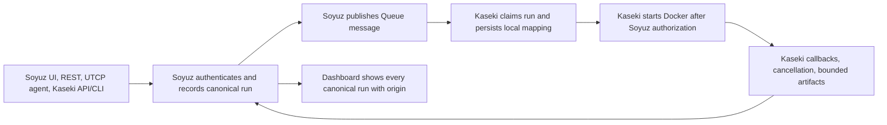

# Unified Soyuz run control plan

> Historical planning document. Its count-based and long-lived Kaseki-history assumptions are superseded by [Phase ABC persistence and retention](PHASE-ABC-PERSISTENCE-RETENTION.md), which sets the canonical 90-day maximum across factory-owned operational history.

## Outcome

Soyuz is the canonical control plane and history for every accepted Kaseki execution, regardless of where the request originates. Kaseki remains the execution host: it owns readiness checks that require the host, Docker, repository access, agent execution, validation, and publication. Soyuz owns canonical run identity, admission, queueing, lifecycle state, cancellation intent, and the dashboard history.

The request may originate in Soyuz, Kaseki's API, Kaseki's CLI, or another approved caller. Every normal managed-mode path must create or resolve the canonical Soyuz run before Kaseki starts work. Keep Kaseki's explicit `POST /api/v1/runs/local` path as a permanent, operator-selected outage/standalone route; it must remain visible and must never activate as a network-error fallback. Kaseki's existing Queue consumer and callback integration remain the execution path for canonical Soyuz runs.

## Current gap and constraints

- Soyuz accepts run requests, writes the canonical row to D1, publishes to the `soyuz-runs` Queue, and reads the dashboard from D1.
- The Kaseki Soyuz adapter and normal API submission routing are opt-in. `POST /api/v1/runs/local` always creates a direct local run; in optional submission mode, `POST /api/v1/runs` and legacy local-run retries can also use the local scheduler.
- The Kaseki adapter already deduplicates Queue deliveries by Soyuz run ID, persists a local mapping, gates Docker start on Soyuz authorization, reports callbacks through a durable outbox, and applies cancellation from canonical state.
- Soyuz's current request contract intentionally does not include Kaseki webhook secrets. Kaseki-specific safety admission and host checks remain necessary.
- Kaseki callers may depend on local IDs and local status endpoints. The migration must preserve a documented compatibility path while moving the canonical ID to Soyuz.

## Kaseki repository assessment

Reviewed Kaseki `origin/main` at [`a25e249dfda35388aa5b98e0fb7c8d10137d0ebc`](https://github.com/CyanAutomation/kaseki-agent/commit/a25e249dfda35388aa5b98e0fb7c8d10137d0ebc) and the current working changes for required submission mode.

- **The CLI has no separate execution bypass.** [`src/cli/commands/RunCommand.ts`](https://github.com/CyanAutomation/kaseki-agent/blob/a25e249dfda35388aa5b98e0fb7c8d10137d0ebc/src/cli/commands/RunCommand.ts) calls its API client's `createRun`; the `--local-direct` flag is explicitly rejected. Its routing follows the Kaseki API submission mode without replacing the CLI's execution model.
- **The API already has both canonical and explicit local submission paths.** With submission routing enabled, `POST /api/v1/runs` and retries of mapped/canonical Soyuz runs use Soyuz's scoped submission identity; `POST /api/v1/runs/local` always schedules locally. In optional mode, a normal create or legacy local-run retry can still create Kaseki-only work. The current working changes add required mode to make the normal route fail closed and reject retries of unmapped local history while preserving `/runs/local`.
- **There is already a useful execution adapter.** [`src/integrations/soyuz/SoyuzAdapter.ts`](https://github.com/CyanAutomation/kaseki-agent/blob/a25e249dfda35388aa5b98e0fb7c8d10137d0ebc/src/integrations/soyuz/SoyuzAdapter.ts) pulls Soyuz Queue messages, checks Kaseki readiness/template/publish/safety, claims the canonical run, persists the external-to-local mapping, and gates local execution on Soyuz's `started` callback. On Kaseki admission rejection it calls `recordSoyuzAdmissionFailure` and queues the terminal callback. This remains the canonical execution path.
- **Kaseki IDs are also local container/job identities.** The scheduler continues to use `kaseki-N` IDs for local jobs, result paths, and Docker cleanup; Soyuz IDs are stored as `externalRunId`. Do not replace the scheduler's internal ID. The API already returns the Soyuz ID for routed submissions and resolves canonical status/detail before local Queue handoff. The local run-list endpoint remains host-local; cross-host listing belongs in Soyuz.
- **Kaseki's request contract is wider than Soyuz's.** [`src/kaseki-api-types.ts`](https://github.com/CyanAutomation/kaseki-agent/blob/a25e249dfda35388aa5b98e0fb7c8d10137d0ebc/src/kaseki-api-types.ts) accepts `webhookConfig` (including an optional secret); Soyuz's strict run request does not. Kaseki rejects webhook-bearing requests when Soyuz routing is enabled; a separate secret custody and delivery design is needed before migrating those requests.
- **Managed admission now runs on the execution host.** Soyuz-routed API creates validate the request contract and idempotency, then the Queue adapter performs host readiness, template/publish/credential, and task-safety checks. Accepted requests rejected there become canonical terminal admission failures. Keep `/api/v1/validate` for synchronous preflight and preserve immediate admission checks for explicit local submissions.
- **Historical detail is bounded.** The Kaseki jobs index defaults to 1,000 terminal entries, while artifact/result retention is separately pruned. A backfill can only promise the records and fields still retained when the importer runs; capture an export before cutover and report missing artifact/detail data.

Phase 0's deployment-specific caller/config inventory is still open. Repository inspection identifies API create/retry and the CLI's API client as normal submission paths, plus the permanent explicit local API route. No production caller telemetry or deployment configuration was available in this source review.

## Recommended decisions

1. **Use one canonical lifecycle for new work.** A Kaseki-originated request calls Soyuz's authenticated run-admission API. Soyuz publishes the Queue message; Kaseki's existing worker claims and executes it. Do not have Kaseki start a local-only run and report it after completion.
2. **Keep origin and actor as trusted metadata.** Soyuz derives the source system from the authenticated service identity. Kaseki may pass a validated originating actor/request reference, but an arbitrary request-body `origin` field must not set provenance.
3. **Fail closed for execution when Soyuz cannot accept the request.** Kaseki may persist a submission intent and retry with the same idempotency key, but must not launch Docker until Soyuz has accepted the canonical run. Any emergency standalone mode must be explicit, visible, and reconciled; it must never be a silent network-error fallback.
4. **Keep execution safety in Kaseki.** Soyuz performs contract validation, authorization, canonical persistence, and queue admission. Kaseki keeps its safety, credential, template, host readiness, and publication checks. Reuse the adapter's existing terminal admission-failure callback when those checks reject a queued run.
5. **Treat old Kaseki history as read-only archive data.** Import it separately from active Soyuz lifecycle rows, with the original Kaseki ID and timestamps preserved. Do not make historical runs cancellable or retryable as if Soyuz had admitted them.
6. **Keep secret-bearing integrations out of the first cutover.** Requests with Kaseki webhook configuration need an explicit secret custody and delivery design. Until then, reject them clearly in managed mode or migrate webhook ownership separately; never silently drop configuration.
7. **Keep direct local submission explicit and permanent.** The operator may choose Kaseki's local API when Soyuz is unavailable. Do not use it automatically after a timeout or uncertain Soyuz response; check canonical state first.

## Target flow

## Delivery phases

### Phase 0 — Production caller and configuration inventory

Repository review establishes that the CLI uses Kaseki's API, canonical API submissions can be proxied to Soyuz, and the console's explicit local form uses `/api/v1/runs/local`. It cannot establish which external clients use these paths, whether production jobs call the scheduler directly, or which hosts have each setting enabled.

Before changing production settings:

- Inventory API, CLI, scheduled, webhook, and internal callers, including authentication, response expectations, status polling, cancellation, and retry behavior.
- Check production host configurations and confirm whether deployments combine API submission and Queue consumption or split those roles.
- Confirm the accepted request mapping and unsupported `webhookConfig` handling. It contains secret-bearing fields and is rejected when Soyuz routing is enabled.
- Preserve the managed-mode contract: invalid requests remain synchronous errors; Kaseki execution-time admission failures on accepted Soyuz runs become canonical terminal outcomes. Keep `/api/v1/validate` and the explicit local submit route.
- Keep `SOYUZ_SUBMISSION_MODE=optional` until the inventory and canary are complete. Required mode is an operator rollout setting, not a new default.

**Exit:** production callers and role-specific configuration are documented, and the canary and rollback plan is agreed.

### Phase 1 — Verify Soyuz provenance and machine authorization

Soyuz `origin/main` already includes the scoped submission identity, trusted provenance, origin-scoped idempotent create, canonical retry/cancel, run outcome summaries, and dashboard provenance. Verify the deployed Worker, schema migrations, token scopes, and Kaseki/Soyuz compatibility before routing production traffic. Provenance must continue to come from authenticated identity; Kaseki's shared API keys do not distinguish CLI callers from other API clients.

**Exit:** deployed API and schema match the current repository contract, and a Kaseki submission is idempotent and visibly attributed without trusting request-body origin labels.

### Phase 2 — Make managed Kaseki submissions fail closed

Kaseki `origin/main` already routes normal create/retry/cancel operations through Soyuz when enabled and keeps the explicit direct endpoint. The current implementation adds an optional/required submission mode: optional remains the default during rollout; required validates the configured submission client and prevents normal create or legacy local retry from silently starting a local run. Keep the CLI on its existing API path. Verify the implementation and deployment-specific API/worker roles:

1. Validate request shape and authenticate the Kaseki caller. Preserve Kaseki's API access checks and local schema normalization.
2. Persist a local submission intent with the stable idempotency key before calling Soyuz. This intent is not executable work.
3. Submit the normalized request to Soyuz using the Kaseki service identity. On timeout or lost response, retry/resolve using the same key.
4. Return the Soyuz UUID as the public canonical `id`. Keep Kaseki's `kaseki-N` as `localRunId` when a worker has created a local job; retain old `kaseki-N` lookups for already-existing jobs. Make Kaseki status/detail routes resolve Soyuz IDs from the durable submission mapping and read canonical status from Soyuz even before the local Queue consumer has created the job. Add deprecation telemetry for clients still using local IDs.
5. Let the existing Queue consumer claim and schedule the canonical run. It must continue to persist the Soyuz-to-local mapping, wait for `started` authorization before Docker, deduplicate redelivery, and use the durable callback outbox.
6. Ensure retries, Kaseki API restart recovery, cancellation, and terminal reporting use the canonical Soyuz ID. A local pending intent must never become a second execution if Soyuz already accepted the request.

For Queue-time Kaseki safety/template/publish rejection, reuse the existing adapter path that claims the canonical row, persists a local admission-failure job, and sends its terminal callback without starting Docker. Managed submissions validate the request contract at the API, then leave host readiness, credentials, template/publish compatibility, and task safety to the execution host. Direct-local submissions keep synchronous host checks. Preserve `/api/v1/validate` for synchronous preflight. Invalid or unauthorized submissions can remain API errors without becoming run rows; decide separately if rejected attempts need a security audit event.

Migrate `POST /api/v1/runs/:id/retry` explicitly. Soyuz already has a canonical retry operation that verifies terminal state, origin ownership, and idempotency, then records `retryOf`. Kaseki routes mapped/canonical retries through it. Required mode must prevent a legacy Kaseki-only retry from starting a new local run; cross-system retries of archived `kaseki-N` records need a separate source-reference contract before implementation.

Preserve the Kaseki `IdempotencyStore` only as a durable submission-response/mapping cache if needed. Soyuz remains authoritative for idempotent admission. If a Soyuz request times out after possible acceptance, Kaseki must retain an uncertain/pending intent and resolve it by retrying the same key; it must not release the key and create a local job.

Kaseki status, list, event, retry, cancel, and detail APIs need an explicit compatibility contract. For canonical UUIDs, return Soyuz state as the lifecycle source and join local execution detail when available. For old `kaseki-N` IDs, continue serving retained local/history data. Artifacts and raw logs remain host-local unless their current retention and Soyuz upload contracts provide them.

Use separate settings for **Queue consumption** and **submission policy**. `SOYUZ_ENABLED` controls the adapter; it does not mean both “consume Soyuz work” and “all normal submissions require Soyuz.” `SOYUZ_SUBMISSION_MODE=optional|required` controls whether normal API create/retry may use standalone behavior or must use Soyuz. Keep the explicit `/api/v1/runs/local` path available in either mode. Validate configuration by deployment role: a submission role in required mode must have a usable Soyuz endpoint and submit credential; an execution role must have the Soyuz Queue consumer enabled and its worker credentials configured. Readiness/health reporting must expose a misconfigured or disconnected role, and required mode must never silently fall back to local scheduling. This supports split API/worker deployments without allowing a deployment that accepts Soyuz submissions but has no configured Kaseki consumer to appear healthy.

**Exit:** every accepted API, CLI, retry, and automated Kaseki request produces one Soyuz row before any execution; Kaseki local state contains a durable mapping, not an independent canonical run.

### Phase 3 — Retain host-local history and reconcile canonical outcomes

- Soyuz's dashboard already shows trusted origins and canonical lifecycle state. Kaseki retains its local job history, logs, and artifacts for diagnostics; do not remove those when enabling shared submission.
- Soyuz's cross-origin outcome summary retains only the newest 30 runs. Keep Kaseki's history as the long-lived host record unless a verified retention and archive contract replaces it.
- Do not import old Kaseki rows into active canonical lifecycle state. If a unified historical archive is still needed, scope it separately as read-only, preserve original IDs/timestamps, and avoid inventing missing prompts, events, claims, or artifacts.
- Confirm production retention and backup settings before reducing any Kaseki local history or result retention.

**Exit:** new Kaseki-originated runs appear in the same Soyuz list as Soyuz-originated runs, with source visible; any separately approved archive is read-only.

### Phase 4 — Verification and controlled rollout

Verify in a non-production environment before enabling required mode:

- Submit through each entry point and verify one Soyuz UUID, one Kaseki local mapping, one execution, and correct origin metadata.
- Exercise `kaseki-agent run` through its existing API client; verify the returned public ID is the Soyuz UUID and Kaseki status routes resolve it before and after local handoff.
- Verify both Kaseki API create and terminal retry paths; retries must point to the source run and remain idempotent after lost responses.
- Retry after a request timeout and after losing the response; confirm idempotent resolution with no duplicate execution.
- Exercise Kaseki validation/safety rejection, host unavailable/capacity full, Queue redelivery, callback retry/outbox recovery, cancellation, terminal failure, and controller restart.
- Confirm the chosen safety-rejection behavior: synchronous validation remains available, while any accepted run rejected by the Queue adapter becomes one terminal canonical record with no Docker execution.
- Make Soyuz temporarily unavailable and confirm Kaseki preserves a pending intent or returns a retryable failure without local execution. Confirm an operator can resolve the same idempotency key safely after recovery.
- Verify the dashboard lists recent runs from both origins, uses canonical creation timestamps, and labels imported records distinctly.
- Verify role-specific configuration guards: required-mode submission without Soyuz credentials fails readiness, and an execution deployment without the Queue consumer or worker credentials is not reported ready. Test the intended split-role topology as well as a combined API/worker deployment.
- Check token scopes, source spoofing attempts, prompt/secret retention behavior, and unsupported webhook handling.

Roll out in this order:

1. Verify the production Soyuz Worker and schema are compatible with current Kaseki submission/Queue contracts; apply any pending migration only through the separate production migration procedure in `DEPLOYMENT.md`.
2. Deploy Kaseki submission support with required mode disabled. Route a small, controlled canary cohort through Soyuz on a non-production Queue/repository first; do not execute both the old and new path as a shadow run.
3. Confirm successful completion, controlled failure, cancellation, duplicate delivery, API restart, and callback retry before increasing traffic.
4. Enable `SOYUZ_SUBMISSION_MODE=required` for production API/CLI entry points in stages. Monitor until direct local-only production starts are zero.
5. Keep Kaseki's retained local history. Run a separate read-only archive project only if a product requirement and retention plan justify it.
6. Retire implicit local scheduling for normal submissions after the compatibility window. Keep the explicit `POST /api/v1/runs/local` path permanently as the visible outage/standalone option.

## Operational safeguards

- **Availability:** Soyuz outage means normal submission fails closed in required mode. Keep submission intents durable and retryable. The operator may explicitly submit through `/api/v1/runs/local`; do not switch to that route automatically.
- **No duplicate work:** stable idempotency keys across every retry; canonical Soyuz ID is the Kaseki deduplication key; keep the existing claim fencing, Queue at-least-once handling, and callback outbox.
- **Security:** separate submit and worker credentials; derive source from identity; never store credentials in run metadata; decide prompt retention explicitly; exclude Kaseki webhook secrets until a separate design exists.
- **Reconciliation:** expose counts for Kaseki submissions accepted by Soyuz, pending submission intents, local jobs without a Soyuz mapping, callback backlog, and imported rows. Alert on any production execution without a canonical run mapping, sustained pending submissions, callback backlog growth, or Queue/DLQ failures.
- **Rollback:** stop new Kaseki submissions or restore the previous API deployment only after confirming no accepted Soyuz Queue messages can be duplicated. Preserve local mappings/outbox. Keep every direct-local run visibly local in Kaseki's retained job history; never make fallback invisible.

## Completion criteria

The outcome is complete when:

1. Every accepted production Kaseki API, CLI, retry, scheduled, and automated run has a Soyuz canonical record before Docker starts.
2. The Soyuz ID is the durable cross-service identity; Kaseki's local job ID is an implementation detail or a documented compatibility alias.
3. Repeated submissions, lost responses, Queue redelivery, callback retry, cancellation, and host restarts cannot create untracked or duplicate work.
4. Soyuz's dashboard presents new runs from all origins and clearly identifies their source.
5. Any imported historical runs are clearly marked read-only, and no production execution can silently bypass Soyuz.
6. Operators can detect pending, stalled, unmapped, and callback-undelivered work and follow documented recovery steps.

## Cross-repository implementation map

| Area | Soyuz changes | Kaseki changes |
| --- | --- | --- |
| Provenance/auth | Current main has scoped submit identity and trusted source metadata; verify production token/schema rollout | Current main stores submit credentials separately and maps Soyuz IDs to local jobs |
| Admission | Current main has idempotent create/retry and canonical outcomes | Required mode closes implicit local fallback; host checks run before execution; `/runs/local` remains explicit |
| Identity | Soyuz IDs, origin, retry lineage, and callbacks are canonical | Preserve local IDs/history for logs, artifacts, and standalone operation |
| Execution | Existing Queue, claim fencing, callbacks, cancellation, artifacts | Existing worker adapter remains execution path; no Docker before canonical start authorization |
| Dashboard/history | Current dashboard presents trusted origins and bounded history | Keep host-local diagnostics and history; no mandatory archive import |
| Operations | Deployment verification and reconciliation alerts remain | Caller inventory, canary, role readiness, and recovery procedures remain rollout work |

## Repository ownership and dependency order

### Soyuz work

- Current `origin/main` provides scoped Kaseki submission, origin-scoped idempotency, trusted provenance, canonical retry/cancel, outcome summaries, and dashboard history.
- Remaining work is deployment verification and operational reconciliation for pending submissions, unmapped local execution, callback backlog, and Queue/DLQ failures.
- Keep any future historical archive read-only and separate from active lifecycle rows; no import is required to enable canonical submissions.

### Kaseki-agent work

- Current `origin/main` has the Soyuz submission proxy, durable idempotency/mapping, the Queue adapter, canonical status/retry/cancel, and an explicit local submission API/UI route.
- This change adds `SOYUZ_SUBMISSION_MODE=optional|required`; optional stays the compatibility default, while required fails closed for ordinary create/retry and leaves `/api/v1/runs/local` available by explicit choice.
- Keep Kaseki local history and artifacts. Production caller inventory, role-specific readiness, alerting, and recovery procedures remain rollout tasks; do not switch production defaults before those are checked.

### Can either side go first?

Soyuz's canonical submit/retry contracts are already present on `origin/main`, so repository implementation can proceed against them. Verify the deployed API and Queue compatibility before enabling Kaseki required mode. Inventory production callers, preserve the retained-history snapshot, and use a canary before changing production settings. An archive importer is optional and remains separate from the live cutover.

## Planning note

This document records the current repository contracts and the remaining rollout plan. It does not authorize production migrations, deployment, production configuration changes, or executable submissions.
