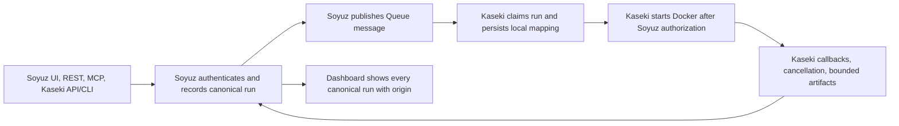

# Unified Soyuz run control plan

## Outcome

Soyuz is the canonical control plane and history for every accepted Kaseki execution, regardless of where the request originates. Kaseki remains the execution host: it owns readiness checks that require the host, Docker, repository access, agent execution, validation, and publication. Soyuz owns canonical run identity, admission, queueing, lifecycle state, cancellation intent, and the dashboard history.

The request may originate in Soyuz, Kaseki's API, Kaseki's CLI, or another approved caller. Every production path must create or resolve the canonical Soyuz run before Kaseki starts work. Kaseki's existing Queue consumer and callback integration remain the execution path.

## Current gap and constraints

- Soyuz accepts run requests, writes the canonical row to D1, publishes to the `soyuz-runs` Queue, and reads the dashboard from D1.
- The Kaseki Soyuz adapter is opt-in. Kaseki's API and CLI can still create local `kaseki-N` runs without a Soyuz row.
- The Kaseki adapter already deduplicates Queue deliveries by Soyuz run ID, persists a local mapping, gates Docker start on Soyuz authorization, reports callbacks through a durable outbox, and applies cancellation from canonical state.
- Soyuz's current request contract intentionally does not include Kaseki webhook secrets. Kaseki-specific safety admission and host checks remain necessary.
- Kaseki callers may depend on local IDs and local status endpoints. The migration must preserve a documented compatibility path while moving the canonical ID to Soyuz.

## Kaseki repository assessment

Reviewed the public `main` branch at commit [`1fba31bf196c5206cdbfb26ed5e7cbc43a1ff097`](https://github.com/CyanAutomation/kaseki-agent/commit/1fba31bf196c5206cdbfb26ed5e7cbc43a1ff097) through the GitHub connector.

- **The CLI has no separate execution bypass.** [`src/cli/commands/RunCommand.ts`](https://github.com/CyanAutomation/kaseki-agent/blob/1fba31bf196c5206cdbfb26ed5e7cbc43a1ff097/src/cli/commands/RunCommand.ts) calls its API client's `createRun`; the `--local-direct` flag is explicitly rejected. Once the Kaseki API is routed through Soyuz, this CLI path follows it without replacing the CLI's execution model.
- **The Kaseki API is the main local-run bypass.** In [`src/kaseki-api-routes.ts`](https://github.com/CyanAutomation/kaseki-agent/blob/1fba31bf196c5206cdbfb26ed5e7cbc43a1ff097/src/kaseki-api-routes.ts), `POST /api/v1/runs` performs Kaseki request, publish/template, and task-safety checks, uses a local `IdempotencyStore`, then calls `scheduler.submitJob`. `POST /api/v1/runs/:id/retry` also creates work with `scheduler.submitJob`. These are the two production submission paths to migrate first.
- **There is already a useful execution adapter.** [`src/integrations/soyuz/SoyuzAdapter.ts`](https://github.com/CyanAutomation/kaseki-agent/blob/1fba31bf196c5206cdbfb26ed5e7cbc43a1ff097/src/integrations/soyuz/SoyuzAdapter.ts) pulls Soyuz Queue messages, checks Kaseki readiness/template/publish/safety, claims the canonical run, persists the external-to-local mapping, and gates local execution on Soyuz's `started` callback. On Kaseki admission rejection it calls `recordSoyuzAdmissionFailure` and queues the terminal callback. This can remain the single execution path.
- **Kaseki IDs are also local container/job identities.** The scheduler continues to use `kaseki-N` IDs for local jobs, result paths, and Docker cleanup; Soyuz IDs are stored as `externalRunId`. Do not replace the scheduler's internal ID. Make the Soyuz ID the public canonical ID in managed-mode responses, retain `localRunId` as a compatibility/detail field, and let Kaseki read routes resolve canonical IDs even before the local Queue consumer has created its job.
- **Kaseki's request contract is wider than Soyuz's.** [`src/kaseki-api-types.ts`](https://github.com/CyanAutomation/kaseki-agent/blob/1fba31bf196c5206cdbfb26ed5e7cbc43a1ff097/src/kaseki-api-types.ts) accepts `webhookConfig` (including an optional secret); Soyuz's strict run request does not. Managed mode needs an explicit rejection or separate webhook migration for such requests.
- **Kaseki currently runs publish/template and task-safety checks before local idempotency and scheduling.** The Queue adapter repeats those checks for Soyuz work. In managed mode, make the adapter the authoritative execution-time gate so checks are not duplicated and can be evaluated against the host that will execute the work. Keep `/api/v1/validate` available for synchronous preflight. This changes create-route behavior for execution-time rejection: valid requests can be accepted into Soyuz, then finish with a canonical admission failure without Docker starting.
- **Historical detail is bounded.** The Kaseki jobs index defaults to 1,000 terminal entries, while artifact/result retention is separately pruned. A backfill can only promise the records and fields still retained when the importer runs; capture an export before cutover and report missing artifact/detail data.

This assessment narrows Phase 0: it still needs a deployment-specific caller/config inventory, but the repository entry-point inventory identifies API create and retry as the core paths and the CLI as an API client.

## Recommended decisions

1. **Use one canonical lifecycle for new work.** A Kaseki-originated request calls Soyuz's authenticated run-admission API. Soyuz publishes the Queue message; Kaseki's existing worker claims and executes it. Do not have Kaseki start a local-only run and report it after completion.
2. **Keep origin and actor as trusted metadata.** Soyuz derives the source system from the authenticated service identity. Kaseki may pass a validated originating actor/request reference, but an arbitrary request-body `origin` field must not set provenance.
3. **Fail closed for execution when Soyuz cannot accept the request.** Kaseki may persist a submission intent and retry with the same idempotency key, but must not launch Docker until Soyuz has accepted the canonical run. Any emergency standalone mode must be explicit, visible, and reconciled; it must never be a silent network-error fallback.
4. **Keep execution safety in Kaseki.** Soyuz performs contract validation, authorization, canonical persistence, and queue admission. Kaseki keeps its safety, credential, template, host readiness, and publication checks. Reuse the adapter's existing terminal admission-failure callback when those checks reject a queued run.
5. **Treat old Kaseki history as read-only archive data.** Import it separately from active Soyuz lifecycle rows, with the original Kaseki ID and timestamps preserved. Do not make historical runs cancellable or retryable as if Soyuz had admitted them.
6. **Keep secret-bearing integrations out of the first cutover.** Requests with Kaseki webhook configuration need an explicit secret custody and delivery design. Until then, reject them clearly in managed mode or migrate webhook ownership separately; never silently drop configuration.

## Target flow

## Delivery phases

### Phase 0 — Inventory and contract decisions

Before changing either repository:

- Inventory every Kaseki execution entry point: API create/retry routes, CLI commands, scheduled or webhook-triggered work, internal automation, and any direct scheduler calls. Identify callers, their authentication, their expected response shape, and how they poll, cancel, or retry.
- Confirm whether scheduled, webhook, or internal automation paths call `POST /api/v1/runs` or invoke `JobScheduler` directly. The reviewed CLI uses the API, and `--local-direct` is unsupported.
- Compare each accepted Kaseki request against Soyuz `RunRequestSchema`, including defaults, validation and publish modes, startup checks, timeout behavior, and unsupported fields such as webhook configuration.
- Document which Kaseki checks can run before Soyuz admission and which happen only after Queue delivery. Define how accepted requests rejected by Kaseki safety checks are recorded canonically. Invalid or unauthorized HTTP requests need not become run records; accepted jobs that fail Kaseki admission must be visible as terminal outcomes.
- Adopt the managed-mode boundary: malformed, unauthorized, or contract-invalid submissions remain synchronous API errors without a run row; valid submissions are admitted to Soyuz, and Kaseki execution-time safety/template/publish rejection is reported as a canonical terminal admission failure. Keep `/api/v1/validate` for callers needing synchronous diagnostics. This avoids duplicate evaluations and makes accepted rejected work visible in Soyuz.
- Confirm what Kaseki stores durably today for idempotency, local run IDs, pending work, and API restarts. Confirm which API clients require `kaseki-N` IDs and local detail routes.
- Decide which environments can retain explicit standalone execution. Production should use required-Soyuz mode after cutover.

**Exit:** approved source/actor vocabulary, request mapping table, safety-rejection semantics, ID compatibility strategy, and a list of every path that must be routed through Soyuz.

### Phase 1 — Extend Soyuz provenance and machine authorization

Make additive changes in Soyuz:

- Add trusted run provenance to the persisted run model, such as `originSystem`, `originEntryPoint`, and optional `originActor` or `originRequestId`. Derive `originSystem=Kaseki` from its machine identity. Record a finer entry point only when backed by a named API identity or other trusted context; current Kaseki API keys are a shared list and cannot reliably distinguish CLI callers from other API clients.
- Populate provenance from the authenticated caller/service principal. Add a dedicated Kaseki submission identity with only the permissions needed to create runs and resolve idempotent submissions. Keep worker claim/callback credentials separate from submission credentials.
- Preserve the current idempotent admission behavior. Kaseki must send a stable `Idempotency-Key`; retries with identical content resolve to the same Soyuz ID, and conflicting content returns a clear conflict.
- Add the minimum database migration and expose trusted provenance in list/detail/dashboard responses. Existing rows should default to a clear Soyuz/API origin. Do not infer origin from run ID format.
- Version the Queue/callback contract only if the new provenance or safety-rejection semantics require wire changes. Deploy additive readers before writers and record a Kaseki/Soyuz compatibility matrix.

**Exit:** a Kaseki service identity can create one canonical Soyuz run idempotently, and dashboard/API responses identify its source without trusting caller-supplied labels.

### Phase 2 — Route Kaseki-originated requests through Soyuz

Change Kaseki's API submission layer so all entry points share one `submitCanonicalRun` path. The existing CLI already calls the Kaseki API; keep that route and move its server-side destination from the local scheduler to Soyuz:

1. Validate request shape and authenticate the Kaseki caller. Preserve Kaseki's API access checks and local schema normalization.
2. Persist a local submission intent with the stable idempotency key before calling Soyuz. This intent is not executable work.
3. Submit the normalized request to Soyuz using the Kaseki service identity. On timeout or lost response, retry/resolve using the same key.
4. Return the Soyuz UUID as the public canonical `id`. Keep Kaseki's `kaseki-N` as `localRunId` when a worker has created a local job; retain old `kaseki-N` lookups for already-existing jobs. Make Kaseki status/detail routes resolve Soyuz IDs from the durable submission mapping and read canonical status from Soyuz even before the local Queue consumer has created the job. Add deprecation telemetry for clients still using local IDs.
5. Let the existing Queue consumer claim and schedule the canonical run. It must continue to persist the Soyuz-to-local mapping, wait for `started` authorization before Docker, deduplicate redelivery, and use the durable callback outbox.
6. Ensure retries, Kaseki API restart recovery, cancellation, and terminal reporting use the canonical Soyuz ID. A local pending intent must never become a second execution if Soyuz already accepted the request.

For Queue-time Kaseki safety/template/publish rejection, reuse the existing adapter path that claims the canonical row, persists a local admission-failure job, and sends its terminal callback without starting Docker. Keep this outcome distinct from agent execution failure. The current API route evaluates task safety before local scheduling; in managed mode, avoid repeating that evaluation in the API and adapter. Preserve `/api/v1/validate` for synchronous checks. Invalid or unauthorized submissions can remain API errors without becoming run rows; decide separately if rejected attempts need a security audit event.

Migrate `POST /api/v1/runs/:id/retry` explicitly. Soyuz currently has no canonical retry endpoint, while Kaseki retries only a terminal local job with a fresh UUID key and records `retryOf`. Add a Soyuz retry operation (or equivalent server-validated create operation) that verifies the source is terminal, clones the accepted request, uses a new idempotency key, and records a `retryOf` link. During transition, a retry of a pre-cutover Kaseki-only record may create a new Soyuz run referencing the archived `kaseki-N`; it must not recreate the old run as active history.

Preserve the Kaseki `IdempotencyStore` only as a durable submission-response/mapping cache if needed. Soyuz remains authoritative for idempotent admission. If a Soyuz request times out after possible acceptance, Kaseki must retain an uncertain/pending intent and resolve it by retrying the same key; it must not release the key and create a local job.

Kaseki status, list, event, retry, cancel, and detail APIs need an explicit compatibility contract. For canonical UUIDs, return Soyuz state as the lifecycle source and join local execution detail when available. For old `kaseki-N` IDs, continue serving retained local/history data. Artifacts and raw logs remain host-local unless their current retention and Soyuz upload contracts provide them.

Use separate settings for **Queue consumption** and **submission policy**. The existing `SOYUZ_ENABLED` controls the adapter; it should not silently mean both “consume Soyuz work” and “all direct submissions require Soyuz.” Introduce an explicit mode such as `SOYUZ_SUBMISSION_MODE=required|standalone`, keep standalone for development and explicitly approved emergency use, and make required mode the production default after canary. Validate configuration by deployment role: a submission role in required mode must have a usable Soyuz endpoint and submit credential; an execution role must have the Soyuz Queue consumer enabled and its worker credentials configured. Readiness/health reporting must expose a misconfigured or disconnected role, and required mode must never silently fall back to local scheduling. This supports split API/worker deployments without allowing a deployment that accepts Soyuz submissions but has no configured Kaseki consumer to appear healthy.

**Exit:** every accepted API, CLI, retry, and automated Kaseki request produces one Soyuz row before any execution; Kaseki local state contains a durable mapping, not an independent canonical run.

### Phase 3 — Dashboard and run history

- Show an origin badge and, when available, the originating entry point/actor in dashboard summaries and details. Keep source metadata sanitized and avoid exposing prompts, credentials, or raw logs.
- Add an origin filter only if it helps operators; the default view should show all canonical runs newest first.
- Keep run status, cancellation, and terminal state sourced from Soyuz. Kaseki's dashboard/API may link to the canonical Soyuz run while retaining local diagnostic views.
- For historical Kaseki runs, build a one-time, resumable importer into a read-only archive table or equivalent historical read model. Preserve Kaseki IDs and original timestamps, deduplicate on `(originSystem, originRunId)`, and clearly label these records as imported history. Do not fabricate prompts, events, worker claims, or artifacts that Kaseki no longer retains. Keep archived rows out of cancellation, retry, and worker callback routes. Snapshot the paginated Kaseki run index before cutover; it retains at most 1,000 terminal entries by default, and result files have independent retention.
- Decide the historical import boundary: all retained Kaseki history, a date range, or only the most recent operational window. Record import counts and missing fields.

**Exit:** new Kaseki-originated runs appear in the same Soyuz list as Soyuz-originated runs, with source visible; imported history is distinguishable and read-only.

### Phase 4 — Verification and controlled rollout

Verify in a non-production environment before enabling required mode:

- Submit through each entry point and verify one Soyuz UUID, one Kaseki local mapping, one execution, and correct origin metadata.
- Exercise `kaseki-agent run` through its existing API client; verify the returned public ID is the Soyuz UUID and Kaseki status routes resolve it before and after local handoff.
- Verify both Kaseki API create and terminal retry paths; retries must point to the source run and remain idempotent after lost responses.
- Retry after a request timeout and after losing the response; confirm idempotent resolution with no duplicate execution.
- Exercise Kaseki validation/safety rejection, host unavailable/capacity full, Queue redelivery, callback retry/outbox recovery, cancellation, terminal failure, and controller restart.
- Confirm the chosen safety-rejection behavior: synchronous validation remains available, while any accepted run rejected by the Queue adapter becomes one terminal canonical record with no Docker execution.
- Make Soyuz temporarily unavailable and confirm Kaseki preserves a pending intent or returns a retryable failure without local execution. Confirm an operator can resolve the same idempotency key safely after recovery.
- Verify the dashboard lists recent runs from both origins, uses canonical creation timestamps, and labels imported records distinctly.
- Verify role-specific configuration guards: required-mode submission without Soyuz credentials fails readiness, and an execution deployment without the Queue consumer or worker credentials is not reported ready. Test the intended split-role topology as well as a combined API/worker deployment.
- Check token scopes, source spoofing attempts, prompt/secret retention behavior, and unsupported webhook handling.

Roll out in this order:

1. Apply the additive Soyuz migration and deploy a Worker compatible with both existing and new Kaseki clients, following the separate production migration procedure in `DEPLOYMENT.md`.
2. Deploy Kaseki submission support with required mode disabled. Route a small, controlled canary cohort through Soyuz on a non-production Queue/repository first; do not execute both the old and new path as a shadow run.
3. Confirm successful completion, controlled failure, cancellation, duplicate delivery, API restart, and callback retry before increasing traffic.
4. Enable `SOYUZ_SUBMISSION_MODE=required` for production API/CLI entry points in stages. Monitor until direct local-only production starts are zero.
5. Import historical records as a separate job after new-run cutover is stable.
6. Remove the production direct scheduler bypass after the compatibility window. Keep standalone mode available only in explicitly managed non-production or documented emergency procedures.

## Operational safeguards

- **Availability:** Soyuz outage means no new Kaseki execution in required mode. Keep submission intents durable and retryable. Do not automatically fall back to local-only execution.
- **No duplicate work:** stable idempotency keys across every retry; canonical Soyuz ID is the Kaseki deduplication key; keep the existing claim fencing, Queue at-least-once handling, and callback outbox.
- **Security:** separate submit and worker credentials; derive source from identity; never store credentials in run metadata; decide prompt retention explicitly; exclude Kaseki webhook secrets until a separate design exists.
- **Reconciliation:** expose counts for Kaseki submissions accepted by Soyuz, pending submission intents, local jobs without a Soyuz mapping, callback backlog, and imported rows. Alert on any production execution without a canonical run mapping, sustained pending submissions, callback backlog growth, or Queue/DLQ failures.
- **Rollback:** stop new Kaseki submissions or restore the previous API deployment only after confirming no accepted Soyuz Queue messages can be duplicated. Preserve local mappings/outbox. Any emergency direct run must be explicitly marked and later imported/reconciled; never make fallback invisible.

## Completion criteria

The outcome is complete when:

1. Every accepted production Kaseki API, CLI, retry, scheduled, and automated run has a Soyuz canonical record before Docker starts.
2. The Soyuz ID is the durable cross-service identity; Kaseki's local job ID is an implementation detail or a documented compatibility alias.
3. Repeated submissions, lost responses, Queue redelivery, callback retry, cancellation, and host restarts cannot create untracked or duplicate work.
4. Soyuz's dashboard presents new runs from all origins and clearly identifies their source.
5. Any imported historical runs are clearly marked read-only, and no production execution can silently bypass Soyuz.
6. Operators can detect pending, stalled, unmapped, and callback-undelivered work and follow documented recovery steps.

## Cross-repository implementation map

| Area | Soyuz changes | Kaseki changes |
| --- | --- | --- |
| Provenance/auth | D1 migration, authenticated source metadata, scoped submit identity, response fields | Store submit credential securely; provide trusted caller context |
| Admission | Preserve idempotent create/queue; define pre-execution rejection outcome | Route all run entry points through Soyuz; persist/retry submission intent |
| Identity | Canonical origin and optional external reference fields | Map Soyuz ID to local scheduler job; support legacy ID lookup during migration |
| Execution | Existing Queue, claim fencing, callbacks, cancellation, artifacts | Existing worker adapter remains execution path; no Docker before canonical start authorization |
| Dashboard/history | Origin labels/filter; optional read-only archive model/import | Provide paginated historical export and local-to-canonical references |
| Operations | Alerts and reconciliation visibility | Required/standalone mode, submission metrics, durable intents, operator recovery docs |

## Repository ownership and dependency order

### Soyuz work

- Add canonical machine-to-machine admission for Kaseki: scoped submit identity, idempotent create/resolve behavior, and persisted trusted provenance.
- Add a canonical retry operation that validates a terminal source run and records `retryOf`; Kaseki cannot move its retry route until this is available.
- Expose canonical lifecycle state and origin through the API and dashboard, and provide reconciliation visibility for accepted, pending, unmapped, and callback-delayed work.
- Add a read-only archive model/import path only if retained Kaseki history should appear in Soyuz; this is separate from live lifecycle records.

### Kaseki-agent work

- Route API create and retry through a Soyuz submission client with a durable intent, stable idempotency key, and Soyuz-to-local ID mapping. The existing CLI follows the API path.
- Keep the current Soyuz Queue adapter as the execution path; ensure no direct scheduler path starts Docker in required mode, and preserve Kaseki safety checks, local diagnostics, and legacy `kaseki-N` lookups.
- Update Kaseki status/list/detail/cancel behavior to resolve Soyuz canonical IDs while returning local execution details when available. Reject or separately migrate webhook-secret requests.
- Add submission/consumer role configuration checks, metrics, run-index export, and operator recovery guidance.

### Can either side go first?

Yes, with a dependency boundary. Contract decisions and repository work can proceed in parallel. Soyuz's additive identity, admission, idempotency, provenance, and retry contracts must be agreed early; Kaseki can implement against that stable contract and a test stub while Soyuz work is underway. Deploy the compatible Soyuz API and Queue path before enabling Kaseki's required mode or routing production submissions. Kaseki's canonical retry route must wait for Soyuz retry support, though create integration can be built independently. Take the retained-history snapshot before cutover; run the optional archive import after live canonical submission is stable.

## Planning note

This is a design and rollout plan only. It does not change implementation, run tests, apply production migrations, deploy Workers, alter Kaseki configuration, or submit executable work.
